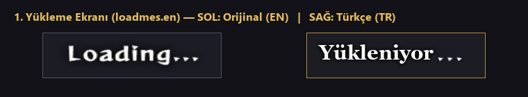
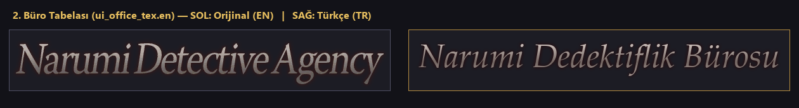
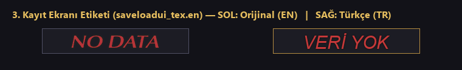
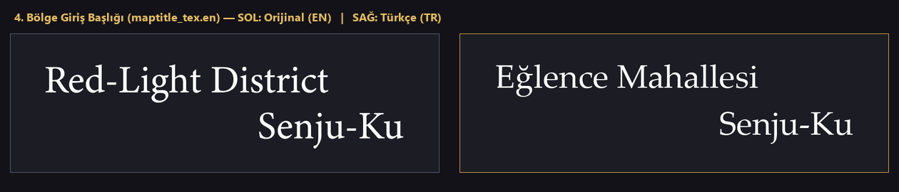
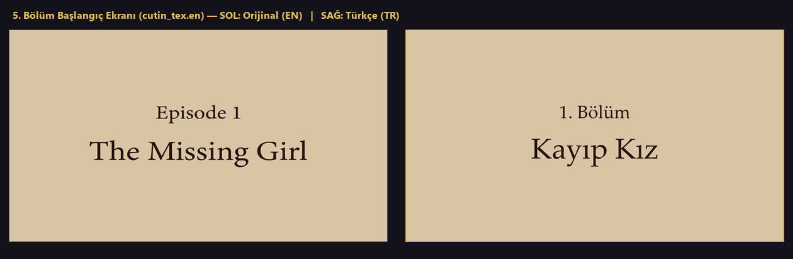
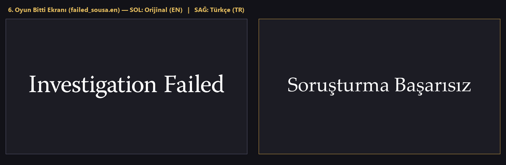
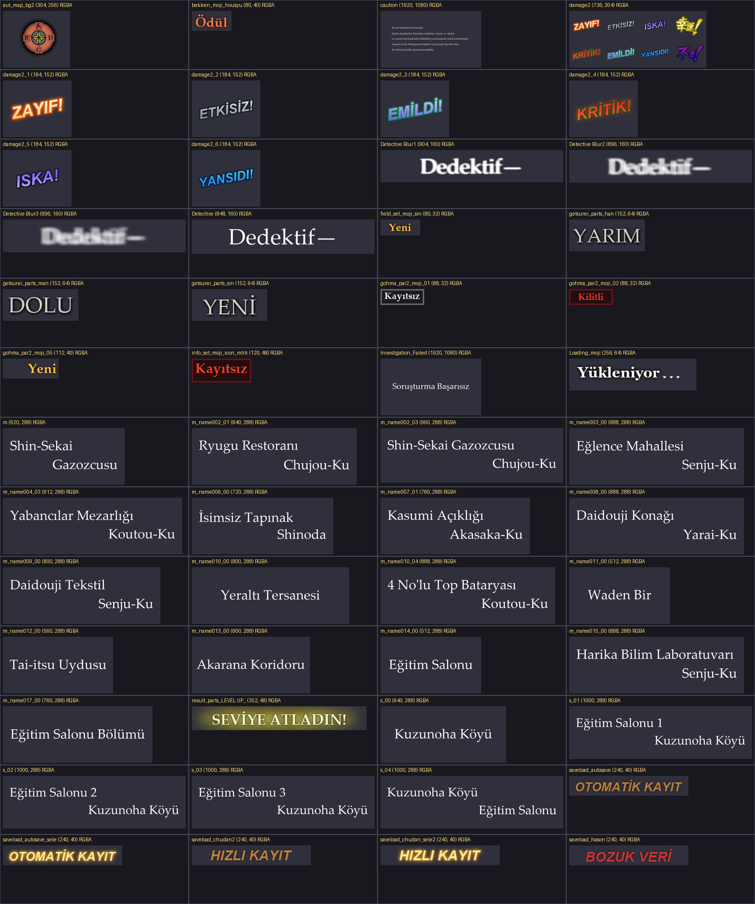
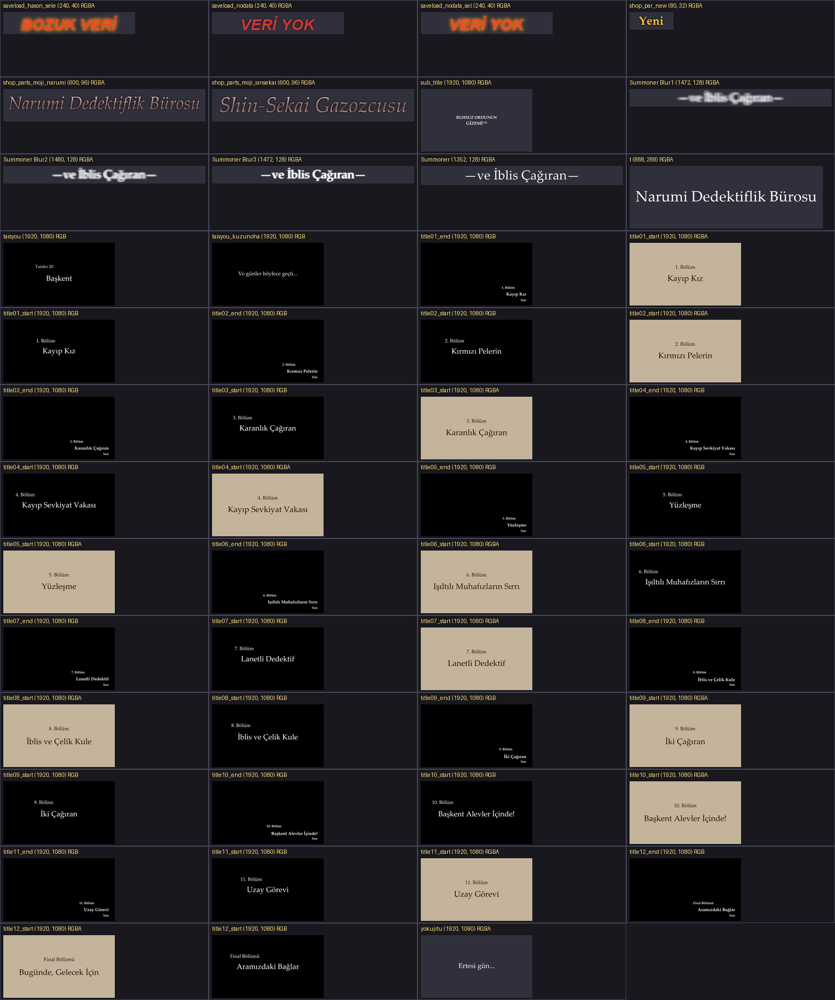

<div align="center">

# 🕵️‍♂️ RAIDOU Remastered: The Mystery of the Soulless Army — Türkçe Yama (%100)

[](#)
[](#)
[](#)
[%20%7C%20Steam%20Deck-informational?style=for-the-badge)](#)

**RAIDOU Remastered: The Mystery of the Soulless Army** (PC / Steam) için tüm ana hikâye diyaloglarını, görev kayıtlarını, menüleri, eşyaları, DLC içeriklerini, Türkçe karakter destekli SDF fontlarını ve **103 adet oyun içi görsel/dokuyu** kapsayan **%100 Türkçe Yama** projesi.

### 👉 [📥 SON SÜRÜMÜ İNDİR (`Raidou_TR_Yama.zip`)](https://github.com/Remilya/raidou-remastered-tr/releases/latest) 👈

</div>

---

## ✨ Yama Özellikleri

- **%100 Metin ve Diyalog Çevirisi (`20.183 / 20.183` Satır):**
  - `12.871` satır hikâye, ara sahne, NPC, iblis müzakeresi ve savaş diyaloğu ([`Spreadsheets/Dialogue.csv`](Spreadsheets/Dialogue.csv)).
  - `7.312` satır arayüz, menü, dedektiflik defteri, vaka kayıtları, eşya/yetenek açıklamaları ve DLC metinleri ([`Spreadsheets/Text.csv`](Spreadsheets/Text.csv)).
- **%100 Türkçe Görsel / Doku Yerelleştirmesi (`103` Doku):**
  - Bölüm başlangıç ve bitiş ekranları (`1. Bölüm: Kayıp Kız` → `Final Bölümü: Aramızdaki Bağlar / Son`).
  - Bölge giriş başlıkları (`Narumi Dedektiflik Bürosu`, `Shin-Sekai Gazozcusu`, `Eğlence Mahallesi / Senju-Ku`, `Yabancılar Mezarlığı`, `Yeraltı Tersanesi` vb.).
  - Kayıt/Yükleme ekranı etiketleri (`VERİ YOK`, `OTOMATİK KAYIT`, `HIZLI KAYIT`, `BOZUK VERİ`), ay evreleri (`YENİ`, `YARIM`, `DOLU`), pusula yönleri (`K, D, G, B`), yükleme ekranı (`Yükleniyor...`), oyun bitti ekranı (`Soruşturma Başarısız`) ve savaş efekt yazıları (`ZAYIF!`, `ETKİSİZ!`, `ISKA!`, `KRİTİK!`, `EMİLDİ!`, `YANSIDI!`).
- **Tam Türkçe SDF Font Desteği:**
  - Oyunun 4 ana SDF fontu (`OptimaNovaLTPro-Medium`, `OptimaNovaLTPro-MediumIta`, `WarnockPro-Regular`, `FOT-ComicReggaeStd-B`) tüm Türkçe karakterleri (`ç, ğ, ı, İ, ö, ş, ü, Ç, Ğ, Ö, Ş, Ü`) sıfır bozulmayla destekleyecek şekilde yamalanmıştır.
- **Tek Tıkla Otomatik Kurulum Aracı (`Raidou_TR_Kurulum.exe`):**
  - Bilgisayarınızdaki tüm Steam kütüphanelerini otomatik tarar, oyun klasörünü bulur ve tek tıkla kurulum/kaldırma yapar.

---

## 🚀 Kurulum Rehberi

### 🪟 Windows (Otomatik Kurulum — Önerilen)

1. [**Releases**](https://github.com/Remilya/raidou-remastered-tr/releases/latest) sayfasından **`Raidou_TR_Yama.zip`** dosyasını indirin ve bir klasöre çıkartın.
2. Klasörün içindeki **`Raidou_TR_Kurulum.exe`** uygulamasını çalıştırın.
3. Kurulum aracı Steam kütüphanenizdeki `Raidou TMOTSA` klasörünü otomatik olarak bulacaktır (farklı bir dizindeyse **Gözat** butonuyla seçebilirsiniz).
4. **✨ Yamayı Kur** butonuna tıklayın ve oyuna girin!

> 💡 **Manuel Kurulum:** İsterseniz `.zip` içindeki `version.dll` dosyasını ve `update` klasörünü doğrudan oyunun kurulu olduğu ana klasöre (`...\steamapps\common\Raidou TMOTSA\`, yani `Raidou TMOTSA.exe` dosyasının yanına) kopyalayabilirsiniz.
>
> 🗑️ **Yamayı Kaldırma:** `Raidou_TR_Kurulum.exe` üzerinden **Yamayı Kaldır** butonuna basabilir veya oyun klasöründeki `Yamayi_Kaldir.bat` dosyasını çalıştırabilirsiniz.

### 🎮 Linux / Steam Deck

1. `Raidou_TR_Yama.zip` içindeki dosyaları oyunun kurulu olduğu ana klasöre (`Raidou TMOTSA.exe`'nin yanına) çıkartın.
2. Steam'de oyuna sağ tıklayıp **Özellikler → Genel → Başlatma Seçenekleri** kısmına şu komutu ekleyin:

```bash
WINEDLLOVERRIDES="version=n,b" %command%
```

---

## 🖼️ Oyun İçi Doku Önizlemeleri (EN vs TR)

| Yükleme Ekranı (`loadmes.en`) | Büro Tabelası (`ui_office_tex.en`) |
| :---: | :---: |
|  |  |

| Kayıt Etiketleri (`saveloadui_tex.en`) | Bölge Giriş Başlığı (`maptitle_tex.en`) |
| :---: | :---: |
|  |  |

| Bölüm Başlangıç Ekranı (`cutin_tex.en`) | Oyun Bitti Ekranı (`failed_sousa.en`) |
| :---: | :---: |
|  |  |

### 🗂️ 103 Türkçe Dokunun Tam Kataloğu

| Doku Kataloğu — Bölüm 1 | Doku Kataloğu — Bölüm 2 |
| :---: | :---: |
|  |  |

---

## 📖 Çeviri ve Terminoloji İlkeleri

Çeviri boyunca *Shin Megami Tensei / Devil Summoner* evreninin yerleşik terminolojisine sadık kalınmıştır ([`Config/Glossary_TR.md`](Config/Glossary_TR.md)):
- **Özel İblis & Büyü Adları Korundu:** Mitolojik iblis adları (`Pixie`, `Jack Frost`, `Ukobach`, `Raiju`, `Yoshitsune` vb.) ve geleneksel SMT büyü adları (`Agi`, `Bufu`, `Zio`, `Zan`, `Dia`, `Megido`, `Tarukaja` vb.) orijinal halleriyle korunmuştur.
- **Japonca Özel İsimler ve Semtler Korundu:** `Raidou Kuzunoha`, `Gouto`, `Narumi`, `Tae Asakura`, `Kaya Daidouji`, `Gouma-Den`, `Konnou-ya`, `Yatagarasu`, `Tsukudo-Cho`, `Ginza-Cho` gibi özel adlar korunmuş; unvanlar ve kurum adları (`On Dördüncü Kuzunoha Raidou`, `Narumi Dedektiflik Bürosu`, `Ruhsuz Ordu`, `Kırmızı Pelerin`) Türkçeleştirilmiştir.
- **Açıklamalar, Hikâye ve Arayüz %100 Türkçe:** Tüm yetenek/büyü açıklamaları, pasif/fiziksel yetenek adları (`Ateş Nefesi`, `İlk Yardım` vb.), eşyalar, vaka dosyaları ve diyaloglar eksiksiz Türkçedir.

---

## 🛠️ Geliştiriciler İçin (Kaynaktan Derleme)

Projeyi kendi bilgisayarınızda düzenlemek veya yeniden derlemek isterseniz (Python 3.12 + `UnityPy` + `Pillow`):

```powershell
# 1. Türkçe dokuları yeniden üret (Content/Texturas içine yazar)
py -3.12 Scripts/generate_all_turkish_textures.py

# 2. CSV çevirilerini JSON'lara aktar, fontları kontrol et, tüm bundle'ları derle ve Raidou_TR_Yama.zip oluştur
py -3.12 Scripts/build_release.py --with-textures --zip
```

---

## ❤️ Katkıda Bulunanlar & Teşekkürler

- **Türkçe Çeviri, Doku Yerelleştirme & Kurulum Aracı:** [Remilya](https://github.com/Remilya)
- **Kullanılan Açık Kaynak Araçlar:** [UnityPy](https://github.com/K0lb3/UnityPy), [UABEA Next](https://github.com/nesrak1/UABEANext)
